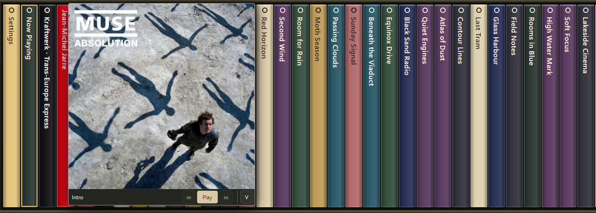

# CD Rack - Home Music

A CD-style music controller for a Synology NAS running Audio Station and a network-connected Denon amplifier. Browse your collection as a rack of jewel cases or a circular carousel of covers and spines. Playback begins when you press Play; optional continuous play then advances through albums in rack order.

**[Try the public demo](https://cd-rack-showcase.vercel.app/)** · **[Read the illustrated user guide](docs/CD-Rack-Guide.pdf)**



## What it does

- Rack and Carousel modes with remembered browser preferences.
- Stationary swipes advance one to four albums; centred arrows and keyboard navigation in Carousel.
- Settings and Now Playing remain pinned album spines in both views.
- Continuous album-by-album playback on the NAS, with remembered Yes/No controls.
- Multi-disc fatboxes, disc/track ordering and compilation grouping.
- Audio Station playback and volume control, including mute restoration.
- Artist, album and date sorting applied by Refresh Rack.
- Persistent catalogue/spine-colour caches and 512-pixel cover thumbnails.
- 30-day app sessions, persistent cookies and read-only NAS keepalive checks.
- A standalone Demo mode with 97 generated sample albums and silent simulated controls. It never needs NAS credentials.
- Empty-library handling that retains Settings and Now Playing.

## Start development

Requires Node.js 22 or later. The application has no npm runtime dependencies.

```sh
cd audio-station-test
node --test
npm start
```

Open `http://localhost:8787`. Choose Demo to try the interface, or sign in to a reachable Synology Audio Station account for real playback. The NAS-hosted installation is described in [NAS setup](audio-station-test/nas/README.md). Use your own hostname and DSM account wherever examples show `YourNASName` or `YourDSMUser`.

## Public demo build and Vercel

```sh
cd audio-station-test
npm run build:demo
```

The standalone site is generated in `audio-station-test/dist/`. The build removes the NAS sign-in form and uses Demo-only configuration. Its explicit asset allowlist excludes the NAS server and deployment material. For a Vercel Git import, choose `audio-station-test` as the Root Directory; `vercel.json` supplies the build command and output directory. No NAS credentials or environment variables are required.

The existing live demonstration is **https://cd-rack-showcase.vercel.app/**. Publishing this repository does not enable automatic updates to that separately created Vercel project.

## Documentation and source layout

| Location | Contents |
| --- | --- |
| `audio-station-test/` | Node service, catalogue/session/thumbnail logic, browser app, tests and deployment scripts |
| `audio-station-test/public/` | UI, generated artwork, local demo receiver and carousel layout |
| `audio-station-test/nas/` | NAS installer and service supervisor |
| `docs/CD-Rack-Guide.pdf` | Illustrated user manual, updated 14 November 2026 |
| `docs/build_user_guide.py` | Reproducible PDF authoring source |
| `docs/assets/` | Guide cover illustration |
| `examples/cd-rack-demo/` | Original standalone rack prototype |

See [guide build instructions](docs/README.md) to regenerate the PDF, and the [application notes](audio-station-test/README.md) for technical behaviour.

## Connection behaviour

The current home-NAS setup uses HTTP on the LAN; trusted HTTPS/reverse-proxy setup is optional and documented separately. Do not expose the NAS service through router port forwarding. The public HTTPS demo is independent of the NAS. No DSM passwords are stored by the app. Session cookies are HttpOnly/SameSite=Strict; service restarts, app deployments or NAS restarts require a fresh sign-in. Album browsing, refresh and volume changes never start music. Continuous play advances after a playing album finishes; selecting Yes while stopped does not start playback.

This public source snapshot includes generic host/account examples. Local account catalogues, session data, logs, SSH keys, credentials and private working notes are not part of the repository.
